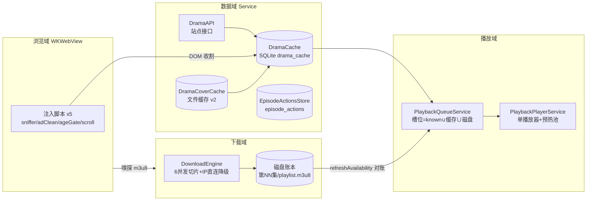

# iOS 代码与设计审查报告（2026-11-15）

> 审查对象：`iOS/SmartDownloader/`（21,590 行 Swift，44 文件）+ `iOS/LaunchSplashView.swift` + `iOS/smoke/` + 工程配置。
> 审查维度：架构与 SOLID · 数据流与并发 · 设计与交互合理性 · 行业规范符合性。
> 审查方式：五路并行独立审查（每路通读所辖域全部源码）+ 关键发现逐条回源码核实（本报告所列 P0/P1 全部经过二次验证，证据行号均为当日实读）。
> 判据：`AGENTS.md`（开发契约）+ 通用 SOLID 原则 + Nielsen 可用性启发式 + Apple HIG/行业惯例。
> 详细发现底稿：`review-scratch/01~05-*.md`（五份，共 ~120 条，本报告为其核实后的汇总与裁决）。

---

## 1. 执行摘要

**总体结论：这是一个分层纪律执行质量显著高于平均水平的 iOS 项目，五层边界、并发约定、诊断日志三大体系不是纸面宣言而是真实落地的；但存在 1 个真实的并发崩溃风险（P0）、一批单点可修的正确性缺陷（P1），以及三条正在产生真实成本的系统性债务：UIKit 侧裸色值双源维护、内嵌 JS 零回归网、无障碍体系缺口。**

| 维度 | 评分（5 分制） | 一句话 |
|---|---|---|
| 分层架构与依赖方向 | ★★★★☆ | 五层边界逐文件核查基本全绿，例外均有记录或属灰色地带 |
| SOLID | ★★★★☆ | SRP 有 4 个千行文件待拆；DIP 的「无协议」是合理权衡而非缺陷 |
| 数据流与并发 | ★★★☆☆ | 代际令牌/后台化成体系，但 SQLite 连接管理与一处无锁共享拖后腿 |
| 设计与交互 | ★★★☆☆ | 状态完备性、防错恢复出色；一致性与可达性有体系性缺口 |
| 行业规范 | ★★★★☆ | 错误处理/日志/命名/防强解包好于多数同规模项目；测试是最短板 |

**必须优先处理的 5 件事**（详见 §8 路线图）：

1. **P0-1** `DownloadEngine` 三个跨线程 `static var` Set/Dictionary 无锁共享——蜂窝/WAF 场景现实可达的崩溃路径；
2. **P1** `DramaFavorites` 全部 3 个方法不关 SQLite 连接——每次调用泄漏一个连接，长会话可致收藏静默失效；
3. **P1** `seek(fraction:)` 里无条件置手势仲裁闸门——「更多 → 从头播放」之后点按暂停与长按 2x 静默失效；
4. **P1** 裸色值双源已实证漂移（全屏选集描边 `#A04D42` vs token `#A05142`）——30 处裸 hex 需要 token 化收口；
5. **P1** AGENTS 第 24 条声称的去重冒烟在仓库中不存在——承重逻辑无回归网。

---

## 2. 评审范围与方法

| 分路 | 范围 | 行数 | 产出 |
|---|---|---|---|
| 01 播放域+组装根 | `player/` 24 文件 + `App.swift` | 8,015 | P0×0 P1×2 P2×13 |
| 02 数据域 | `Drama/` + `Profile/` 15 文件 | 6,414 | P0×0 P1×5 P2×14 |
| 03 下载/浏览/基础设施 | `Downloads/` + `Browser/` + `Infra/` 20 文件 | ~3,900 | P0×1 P1×3 P2×12 |
| 04 设置/共享/横切面 | `Settings/` + `Components/` + `Shared/` + pbxproj + smoke | ~2,400 | P0×0 P1×1 P2×9 |
| 05 设计与交互专项 | 11 个 View 文件 + 共享层判据阅读 | ~7,000 涉读 | P0×0 P1×6 P2×9 |

- 全库脚本化核查（约定符合性硬数据）：`UIScreen.main` **0** 使用；`try!`/`as!` **0**；TODO/FIXME **0**；`print` 日志 472 处；async/await 恰好 **2** 处（均在 AGENTS 例外清单内）；`UserDefaults.standard` 仅出现在 **4** 个 Service 文件。
- 严重度口径：**P0** = 正确性/崩溃/数据丢失风险；**P1** = 违反 AGENTS 明文约定或明显正确性/架构缺陷；**P2** = 改进建议与债务记录。
- 汇总口径：原始发现 P1×17 / P2×57，跨路重复合并后 **P0×1、P1×14、P2×53**。全部 P0/P1 经我在源码逐条复核；P2 保持原路证据未逐条重验。

---

## 3. 总体架构评价

### 3.1 分层架构：成立且执行严格

AGENTS 定义的 `View → ViewModel → Service → 系统能力/Model` 单向依赖，逐文件核查结果：

- **Service 层纯度：全绿。** 全库 15+ 个 Service（DramaCache/DramaDatabase/DramaCoverCache/DramaFavorites/EpisodeActionsStore/DramaAPI/QuickLinkStore/AppLaunchPreferences/DramaRoutePreferences/DownloadsSortPreferences/PlayerPreferences/BrowserStartPage/ScrollCollapsePolicy/AppHaptics/KeyboardObserver 等）**零 `import SwiftUI`、零 `@Published`**（脚本核查 + 逐文件复核）。「删掉 UI 后逻辑仍成立」的判据在绝大多数 Service 上成立。
- **VM 层约束：基本全绿，1 处违规。** VM 无 `UserDefaults`/`FileManager`/`URLSession`；AVPlayer 只在 `PlaybackPlayerService` 创建。唯一例外：`ProfileViewModel` 直接 `import SQLite3` 写裸 SQL（P1-④，见 §6）——这条是 2026-11-15 性能修复时绕开 Service 层留下的，口径（「连载中」LIKE 判定）也因此写死在 VM。
- **View 层：3 处业务判断残留。** `DownloadsView.playIfDone`（失败重试 + 播放器选型路由在 View 里，P1-⑨）；「我的」页占位死按钮零反馈；其余主要 View 的业务判断已收口到 VM/Service。
- **组装根：基本干净。** `DramaPlayerContainer`（39 行）只做注入；`App.swift` 附带卡顿探针/自动冒烟/`profileDetailActive` 复位逻辑（P2，建议移入 Debug 工具文件，与 `PlayerPreviewEntry` 同类做法）。

### 3.2 域划分与共享层

- 按功能域分组（而非按层分组）的目录结构在实际演化中证明了价值：一个功能的四个文件在一处，域内分层一眼可查。
- `Shared/` 零污染：7 文件全部纯数据/设计系统，跨域引用均 ≥2 域，无 IO、无 @Published。
- `Components/PosterGrid` 是组件化的正面样板：`selection: Bool?` 纯视觉入参，三处调用（剧集页推荐/我的封面墙/已下载网格）零业务依赖，点击导航全部留在调用方。
- `MainTab` 单一来源完整执行：全库 grep 无第二处 tab 图标硬编码。

### 3.3 一致性：AGENTS 拍板记录与实现逐条可对上

审查中抽查的高风险约定——手势仲裁（AGENTS 2）、冻帧换集（12）、选集面板集号补全（19）、同集去重三源收口（24）、封面证据链（22）、下拉刷新（14/15）——实现与约定逐条吻合，且成因注释完整（用户实报原文 + 编号成因），审计时不需要反向推理。**这个项目最大的工程资产是「决策-实现-文档」三者同步。** 相应的债务也来自同一处：文档行号漂移（AGENTS 12 写的简介块 398–625 实际已漂移到 880–1110）、AGENTS 24 引用的冒烟工具源码不在仓库（见 P1-⑭）。

---

## 4. SOLID 逐原则评估

| 原则 | 结论 | 关键证据 |
|---|---|---|
| **S** 单一职责 | **4 个千行文件待拆**，但拆分点都已论证成熟 | `DramaDetailView` 1682（17 个 @State、6 类区块，五步拆分序列已给出，简介禁区 880–1110 不动）；`Downloader` 1174；`PlayerFullscreenControlsView` 1061（底部 210 行是 4 个无状态耦合的图标类，可拆 `PlayerFullscreenGlyphs.swift`）；`PlayerFullscreenController` 1000（抽屉呈现 ~250 行与动画/手势无共享状态，可拆 `FullscreenDrawerController`）；`DramaPlayerViewModel` 922（HUD 瞬态机/加载协调器两块已具「第二个变更理由」） |
| **O** 开闭 | **良好**。扩展点靠数据驱动 | `MainTab.allCases`、`rateOptions` 五档一处给出、`PaperGlyphs` 图元库、`EpisodeGridMetrics.columns` 配置化 |
| **L** 里氏替换 | **不适用/无违例**。全库无协议继承体系，唯一 class 系 Service（`DramaRoutePreferences`）与同构 struct 并存属模式噪音（P2） | |
| **I** 接口隔离 | **以「纯函数小接口」形式达成** | `PlayerGesturePolicy`/`ScrollCollapsePolicy`/`DramaArchive.sections`/`bindRecCovers`——决策逻辑收进无状态纯函数，天然最小接口 |
| **D** 依赖反转 | **有意的反权衡，结论：维持。** 7 个 Service 全静态、零协议注入。测试策略是 smoke 冒烟（编译真实代码打真实流）而非 mock 测试，静态 Service 与该策略自洽；为测试引入 7 协议 + 7 fake 正是 AGENTS 第 9 条禁止的「硬造协议」。**真实缺口不在协议缺失，而在决策逻辑与 IO 缠绕**——revalidate diff、downloadPhase 映射、mergedWithLocalState 三处改纯函数入参即可补齐可测性，零协议成本 | `DramaPageViewModel.swift:443-457` 等三处 |

**SOLID 总评：这个项目对「不为分层而分层」的执行反而让它躲开了最常见的 SOLID 化陷阱（协议泛滥）。当前真正违反 SRP 的证据是 P1-①（`seek(fraction:)` 同时是播放 API 与手势仲裁置位点——职责混装直接产出了正确性 bug）。**

---

## 5. 数据流与并发审查

### 5.1 主数据流（现状，已核实）

**数据流判定：**
- 播放侧「磁盘是唯一事实」的对账纪律（每次停稳 `refreshAvailability`）与下载侧「账本-目录-列表三处同源」的去重收口，两条主数据流的一致性设计是健全的。
- SQLite 访问模式为「每次调用自开自关连接」（每剧集页 load ≈6 次开关）。该模式简单可靠，但有三个系统性问题：**无 WAL**（全库 0 处 `journal_mode`，读并发与写并发互相阻塞，busy_timeout 仅 100ms，读撞锁后静默返空列表）；**连接开关手写不均**（DramaCache 15 处 close、EpisodeActionsStore 11 处、DramaFavorites **0 处**——P1-③）；**事务覆盖不全**（`saveDetail` 大事务已包，`reconcileDownloaded` 逐行 autocommit 未包，P2）。
- 索引与查询：`drama_episodes` 全部查询命中 PK 前缀；`drama_cache` 无 name/fetched_at 索引，`resolveDramaID` 全表扫 + 每行一次 `sanitizeTitle`，位于选集面板打开的热路径（P2，缓存剧目上百后可测）。SQL 注入面：全部用户数据走参数绑定，无插值拼接，**干净**。
- 读放大仍有残留：Profile 装配 history/favorite/liked 三分类仍逐条 `DramaCache.load`（追更已用子查询消灭 97 次 load，同思路可做 `rows(forIDs:)` 一次取回）——后台队列化只治了卡 UI，没治读放大（P2）。

### 5.2 并发模型：体系成熟，一处硬伤

- **做对的（成体系）**：全库 GCD 化彻底（async 岛恰好 AGENTS 例外清单内 2 处）；可变状态主线程访问 + 后台回调显式回主线程；`DispatchWorkItem` + **代际令牌**（loadGeneration/settleGeneration/refreshGeneration/reloadGeneration）+ 幂等标志（`systemPanLocked`/`pruneScheduled`）贯穿全库；主线程零 semaphore。DownloadsViewModel/PlaybackProgressViewModel/ProfileViewModel 三套「后台化管线」是可直接复用的范本。
- **P0 硬伤**：`DownloadEngine` 三个跨线程共享的 `static var`（`ipDirectHosts: Set<String>`、`dnsCache: [String: [String]]`、`preferWebKit: Bool`）无任何同步（Downloader.swift:785-788，注释称「良性竞争不加锁」）。写点在 6 并发切片线程（:731/:826）。`preferWebKit` 是 Bool，良性竞争的注释对它成立；**对 Swift Set/Dictionary 不成立**——并发写可致存储结构损坏。触发条件恰是蜂窝/WAF 整批连接层失败，现实可达。修法：两个集合收敛进串行队列或 NSLock，改动面仅 3 处。
- **同型小问题**：`DramaCoverCache.didCleanLegacyFiles` 静态 Bool 跨线程裸读写（实践中良性，顺手修）；`pruneScheduled` 布尔合批标记会在同 runloop 两个 done 时丢弃第二个的去重（P1-⑧，改待处理队列）。

---

## 6. 设计与交互合理性

### 6.1 做得好的（有据可查）

- **状态机范本**：下拉刷新三态（峰值判定防回弹误判、10s 兜底解锁、失败不演「已更新」）；手势仲裁「先起者独占」含全部兜底分支；破坏性操作全部有确认且文案说后果。
- **错误透出体系完整**（AGENTS 21 全链闭环）：网络层原始事实日志 → `badBody(snippet:)` → `diagnosticText` → 可滚动等宽详情块 + 一键复制 + 重试。
- **禁用态诚实**：「下载全部」全可播已下置灰 + a11y hint；浏览页按钮文案随状态走。
- **组件一致性有架构保证**：PosterGrid 三处共用一张卡；VoiceOver 在新增域（选集面板/全屏控制层/tab bar）覆盖成体系。

### 6.2 问题（按对用户的影响排序）

**① 术语口径分裂（P1，会产出语义错误而不只是文案问题）**
- **「已看完」双口径互斥**：下载页 = 播放到距片尾 5s（`PlaybackProgress.isFinished`）；「我的」筛选 = 最后一集已下载（`ProfileViewModel.lastEpisodeFinished`）。一集没看但下完全剧的剧会进「已看完」筛选——与用户预期相悖。
- 「已加入下载队列」同语义 3 通道 2 种集号写法（「第 N 集」vs「第N集」）；「已入队 N 集」/「已加入下载队列」/「站点未开放下载」/「站点未开放」同义异形散布四文件。

**② 无障碍体系缺口（P1，最重的体系债）**
- Dynamic Type 全库不支持（`DWFont` 固定字号工厂）；`BrowserView`/`DownloadsView`/`PosterGrid`/`PlayerFeedView` 零 accessibility 修饰符——VoiceOver 用户在下载页无法完成取消/重试/编辑/排序；`.onTapGesture` 当按钮的行（下载页播放行、简介胶囊）VoiceOver 无法激活。全库 accessibility 修饰符仅 58 处且集中在播放域。

**③ 命中区系统性小于 44×44（P1）**
- 10 种命中尺寸（12/18/20/22/24/26/32/34/38/40pt）散布纸本轨三页与抽屉：浏览页前进/后退/刷新 20×20（高频低容错）、抽屉关闭钮 20×20（而竖屏同语义是 44×44）、取消/重试圆钮 26×26。播放域反而有现成范本（`centered(at:size:44)`）。建议统一「视觉框 + 透明命中层」方案，不动视觉。

**④ 双轨视觉与双源实现（P1）**
- 纸本轨五页 vs 播放页墨本轨的双语言并存是既定选择，但 **UIKit 侧 30 处裸 hex 与 DWColor 双源重复**已经兑现为真实漂移：全屏选集当前集描边 `#A04D42@0.5`（FullscreenDrawers:466）vs 竖屏面板 token `#A05142`（DesignTokens:147）。约 24 处裸值与既有 token 同值异名，全屏控制层还私设了第二个 `UIColor(hex:)` 解析器。建议加 `DWUIColor` 镜像层收口。

**⑤ 状态反馈缺口（P2，逐条可修）**
- 浏览页无页面加载进度指示（点「访问」到 didFinish 之间无反馈，弱网像死机）；
- 「我的」页装配期间空态先现（有观看记录的用户每次进页闪一下空态）；
- 「我的」页四个占位死按钮零反馈（可点击外观 + 零反馈 = 用户以为坏了）；
- 播放页空态用系统蓝 `borderedProminent`，与「朱砂唯一强调色」体系冲突（全 App 仅此一处漏网）；
- 触觉不成体系：`AppHaptics.success()` 注释宣称的「单集下载完成」全库无调用点；主 tab 切换无触觉而「我的」分类 tab 有。

**⑥ 可学习性（P2）**
- 五套手势（长按 2x / 横向相对 seek / 清屏 / 边缘返回 / 滚动收起联动）零引导；误触恢复侧反而成熟。建议给长按 2x 做一次性 toast 引导。

**⑦ 对比度（P2，需设计侧拍板）**
- 画布实读色 `paperInkSub`（2.8:1）/`paperFaint`（2.14:1）/`paperLineIdle`（1.68:1）对宣纸底均低于 WCAG AA，且承载 9–11pt 小字。色值受「画布实读禁止目测改」约束，应回设计稿提诉求。

**⑧ 已拍板决策的代价归档（不翻案）**
设置页返回 12pt 布局宽（可用透明命中层两全）；清屏图标沿用「画面适配」的语义转移；面板标题位当提示通道的 2.4s 挤占；浏览页切 tab 即退出剧集页；站点编辑器删除无确认（与「恢复默认」的确认标准不对齐，建议补齐）。

---

## 7. 行业规范符合性

| 维度 | 结论 |
|---|---|
| 错误处理 | **好**。无 `try!`/`as!`（全库唯一强解包 `DramaMetaHarvester.swift:248`，P2）；错误链路分层透出；2 处静默失败分支违反自家日志约定第 4 条（`QuickLinkStore.load` 解码失败静默回落默认、BUSY 读静默返空） |
| 日志 | **密度高且成体系**（PLAYER_DBG 分类标签 + 472 处 print + 断言行带输入值）。注意点：`cacheLoad` 逐集拼接日志单行可达 1KB × 装配期百余次，后台化后已不影响 UI，但量级值得观察 |
| 命名与组织 | **好**。域内分层命名一致；两处例外：`FullscreenDrawers` 与 `EpisodePanel` 命名未能传达「竖屏面板 vs 全屏抽屉」的对应关系；`ToastView.toast()` 修饰符死代码 |
| 工程配置 | **与文档一致**。Swift 5 + minimal 锁定三配置同值；folder-sync + Info.plist 排除集正确；两处卫生问题：版本号双源（Info.plist 硬编码 vs pbxproj 变量未注入，P2）、`NSAllowsArbitraryLoads=true` 上架需说明（个人项目口径，可接受） |
| 测试 | **最短板**。无 XCTest target；smoke 5 工具覆盖下载核心/本地服务/站点 API/连通性，但 AES 解密管线、IP 直连降级、`EpisodeActionsStore`、同集去重（AGENTS 24 声称的冒烟源码不在仓库）、手势纯函数均无回归 |
| 资源与隐私 | **基本干净**。临时目录清理纪律在；`DramaMetaHarvester` 无条件向 Documents 写调查文件（每次进剧集页最多 ~10MB 累积，无门控无清理，P2 建议加 `-captureDramaMeta` 开关）；`DramaAPI` 每请求新建 ephemeral URLSession 且不 invalidate（P2） |

---

## 8. 问题清单

> P0/P1 全列（核实后的合并口径）；P2 按主题归纳，逐条细节见 `review-scratch/` 对应文件。

### P0（1 条）

| # | 位置 | 问题 | 建议 |
|---|---|---|---|
| **P0-1** | `Downloads/Downloader.swift:785-788, :731, :826` | `ipDirectHosts`(Set)/`dnsCache`(Dict) 跨线程无锁共享，6 并发切片线程同时写；注释「良性竞争不加锁」对 Bool 成立、对 Set/Dict 不成立 | 两个集合收敛进串行队列或 NSLock（改动面 3 处）；`preferWebKit` 可保持裸 Bool |

### P1（14 条）

| # | 位置 | 问题 | 建议 |
|---|---|---|---|
| **P1-①** | `player/DramaPlayerViewModel.swift:520` + `player/DramaPlayerView.swift:499` | `seek(fraction:)` 顶部无条件置 `isSeekGestureActive`，菜单「从头播放」路径无配对复位 → 之后点按暂停与长按 2x 静默 SKIP，直到下次横滑/切集 | 删该行（两条 pan 路径 `.began` 已独立置位，删除零影响） |
| **P1-②** | `player/PlayerFullscreenControlsView.swift:722-726` | 全屏倍速文案复用 AGENTS 12 已定性修掉的 `"0$"` 字面量替换 bug → 全屏「2.00×」vs 竖屏「2.0×」 | 删 `trimmed`，改用 `DramaPlayerViewModel.rateText` |
| **P1-③** | `Drama/DramaFavorites.swift:13-69` | 3 个方法全部不调 `sqlite3_close`（全文件 0 处）→ 每调用泄漏一个连接，长会话可致 fd 耗尽、收藏静默失效 | 三方法补 `defer close`；长期在 DramaDatabase 加 `withConnection` 统一开关 |
| **P1-④** | `Profile/ProfileViewModel.swift:2, :156-195` | VM 直接 `import SQLite3` 写裸 SQL（追更装配），「连载中」口径写死在 VM，违反 AGENTS 5/7 与五层规则 | 查询下沉 `DramaCache.chasingRows()`，VM 只装配；顺手做 `rows(forIDs:)` 消灭其余读放大 |
| **P1-⑤** | `Profile/ProfileView.swift:67` | `.preferredColorScheme(.light)` 挂 NavigationStack 上，环境沿 `navigationDestination`+`fullScreenCover` 传入播放页（墨本轨）——AGENTS 纸本轨第 1 条警示的同型坑，注释「不影响其它页」与事实不符 | 删除该修饰符（纸本页色值全写死，无需锁）；或下移到封面墙层 |
| **P1-⑥** | `Drama/DramaCache.swift:281-289` | `detailFetchedAt` prepare 失败分支显式 `sqlite3_close` + `defer` 再关 → double close / use-after-free 类缺陷（触发概率低） | 删显式 close，统一靠 defer |
| **P1-⑦** | `Drama/DramaDatabase.swift:276-317` | 旧 UserDefaults 搬迁：标记先置位 + 源键无条件删，写库失败即旧点赞/收藏/进度一次性丢失 | 写失败计数，未全迁成功不删源键不置位（搬迁幂等可重试） |
| **P1-⑧** | `Downloads/Downloader.swift:93-101` | `pruneScheduled` 布尔合批把同 runloop 第二个 done 的去重直接丢弃 → AGENTS 24 要消灭的「并列两条同名」窄窗口复现 | 布尔改待处理队列，排水逐条 prune |
| **P1-⑨** | `Downloads/DownloadsView.swift:772-793` | `playIfDone` 把失败重试条件与播放器选型路由留在 View（违反 View 层硬约束；同文件已有 `handleTap` 收口范式） | 判断与路由下沉 VM/Service，View 只发意图 |
| **P1-⑩** | `Browser/AdCleanerScript.swift` 等 5 份 | ~1000 行启发式注入 JS 内嵌 Swift 字符串：零编译期校验、零自动化回归、5 个 handler 名散落注册/摘除两处——直接对用户网页做删 DOM/点按钮却无回归网 | handler 名单单一常量表；把「本地合成页 + handler 断言」固化为第 5 个 smoke 工具；中长期 JS 抽 `.js` 资源 |
| **P1-⑪** | `player/FullscreenDrawers.swift`(17) + `PlayerFullscreenControlsView.swift`(8, 含第二解析器) + `PlayerFullscreenController.swift`(2) + `LaunchSplashView.swift:48` | 30 处裸 hex 违反 token 纪律，≈24 处与 DWColor 同值异名；**已实证漂移**：选集描边 `#A04D42` vs token `#A05142` | DesignTokens 加 `DWUIColor` 镜像收口；`#A04D42` 对齐回 token；删第二解析器；DramaPlayerView 2 处属用户文件待定夺 |
| **P1-⑫** | 全库 View 层 | 无障碍体系缺口：Dynamic Type 不支持（DWFont 固定字号）；BrowserView/DownloadsView/PosterGrid/PlayerFeedView 零 accessibility；`.onTapGesture` 当按钮 VoiceOver 无法激活 | 先补标签 + `.isButton`/`.isSelected`（零视觉改动）；正文类字号支持 relative sizing |
| **P1-⑬** | `Shared/PlaybackProgress.swift:13` vs `Profile/ProfileViewModel.swift:216` | 「已看完」双口径互斥（播放看完 vs 最后一集已下载）——筛选结果与用户预期相悖 | 统一为播放口径，或「我的」筛选改名「已下完」 |
| **P1-⑭** | `iOS/smoke/` vs AGENTS 24 | AGENTS 声称的同集去重冒烟（5 断言）在仓库源码中不存在，产物目录已 gitignore → 承重逻辑无可跑回归 | 固化为 `deduptest`（或并入 main.swift `--library`），AGENTS 引用具体文件名 |

### P2（53 条，按主题）

**架构与拆分**：DramaDetailView 1682 行五步拆分序列（Debug 样张 → 错误态 → 档案/推荐 → 下拉刷新 → 选集区，简介禁区不动）；DramaPlayerViewModel 抽 HUD 瞬态机与加载协调器；FullscreenGlyphs/DrawerController 拆分；`PlayerOrientationTrigger` 改闭包注入解耦 VM；`App.swift` 探针移 Debug 文件；AppHaptics 注释宣称的「下载完成 success」无调用点；FeedVM 硬实例化 Service。

**数据层**：无 WAL + busy_timeout 100ms 读撞锁静默返空（建议 WAL + 放宽超时 + BUSY 计数日志）；`transaction()` 无 ROLLBACK（saveDetail 可能部分提交）；`reconcileDownloaded` 未包事务；`resolveDramaID` 全表扫 + 逐行 sanitizeTitle（热路径）；DramaAPI 每请求新建 URLSession 不 invalidate；收割器调查文件无门控无清理；`DramaCoverCache.dir` 每访问 createDirectory；迁移标记先行置位（首次迁移失败本进程不重试）；Profile 三分类读放大（`rows(forIDs:)`）。

**下载/浏览**：引擎保存段先删旧目录再 move（中途失败双丢，改临时名过渡）；sink 只进不出（已删任务仍被持有）；删除路径循环内逐条解析身份（主线程 SQLite，与卡顿修复同型）；编辑模式「全选」覆盖无法勾选的下载中任务（勾选数与删除范围不一致）；AdCleaner/AgeGate 常驻定时器 + 每 iframe 拷贝无成本实测账；WebKitFetcher 超时后 waiters 滞留；LocalMediaServer 不支持后缀 Range；deleteSeries 不清剧壳；散装卡无删除入口；PaperCover/PosterGrid 主线程同步解码封面（滚动开销）；`refreshDownloadedSorts` 每进度 tick 全目录扫盘；ScrollCollapsePolicy 纯函数化只完成一半（键盘/聚焦/静默窗守卫留 View）。

**设置/共享/工程**：「恢复默认」后默认圈落「显式无默认」态与出厂不一致；SettingsView 私有复制 PaperGlyphs 三图元；版本号双源；`DramaRoutePreferences` 独一份 class；QuickLinkStore 解码失败静默无日志；ToastView `.toast()` 死代码；smoke 覆盖缺口（AES/IP 直连/EpisodeActionsStore/手势纯函数）。

**设计与交互**：对比度低于 AA（paperInkSub 2.8:1 / paperFaint 2.14:1 / paperLineIdle 1.68:1，需回设计稿）；触觉不成体系（下载完成无触觉、主 tab 与子 tab 不对齐）；「我的」占位死按钮零反馈；浏览页无加载进度；「我的」装配期空态先现；播放页空态系统蓝；用户文件 DramaPlayerView mock 文案残留（「从第 1 集开始看」/「热评」/「免费观看」）；手势零引导；命中区 <44 清单（10 种尺寸）；AGENTS 12 简介块行号漂移（398–625 → 实际 880–1110）；`DownloadsViewModel` 注释落后一个版本；全屏「下一集」跳号场景静默落空；0.25s tick × 4 @Published 全卡片重估；refreshCardsIfNeeded O(N) 全量重建。

---

## 9. 改进路线图

**立即修（半天内，全部单点小改）**
1. P0-1：`ipDirectHosts`/`dnsCache` 加锁；
2. P1-③：DramaFavorites 三方法补 `defer close`；
3. P1-①：删 `seek(fraction:)` 里的闸门置位一行；
4. P1-②：删 `trimmed`，全屏倍速走 `rateText`；
5. P1-⑥：删 `detailFetchedAt` 显式 close；
6. P1-⑦：搬迁失败不删源键不置位。

**本周（每条 ≤1 天）**
7. P1-④：追更查询下沉 DramaCache + `rows(forIDs:)`；
8. P1-⑤：删 ProfileView `.preferredColorScheme`；
9. P1-⑧：prune 合批改队列；
10. P1-⑨：playIfDone 下沉；
11. P1-⑬：统一「已看完」口径；
12. P1-⑭：去重冒烟固化入库；
13. P1-⑪：DWUIColor 镜像 + `#A04D42` 对齐。

**中期（按周排）**
14. P1-⑩：JS 冒烟工具 + handler 常量表 + `.js` 资源化；
15. P1-⑫：无障碍第一遍（标签/isSelected/isButton，零视觉改动）+ 命中区 44×44（视觉框 + 透明命中层）；
16. SQLite 健壮性：WAL + BUSY 观测 + `withConnection` + 事务化补全；
17. 千行文件拆分（按 §4 SRP 给出的顺序）；
18. 文档同步：AGENTS 12 行号改锚定符号名、24 条冒烟文件名、两处落后注释。

**设计侧（回画布拍板）**
19. 对比度三色提诉求；「已下完」vs「已看完」命名；主 tab/下载完成触觉补齐；浏览页加载进度条；占位按钮 disabled 态。

---

## 10. 附录：审查分工与底稿

| 底稿 | 覆盖 | 原始计数 |
|---|---|---|
| `review-scratch/01-player-app.md` | player/ 24 文件 + App.swift，8015 行 | P0×0 P1×2 P2×13 |
| `review-scratch/02-drama-data.md` | Drama/ + Profile/，15 文件 6414 行 | P0×0 P1×5 P2×14 |
| `review-scratch/03-downloads-browser-infra.md` | Downloads/ + Browser/ + Infra/，20 文件 | P0×1 P1×3 P2×12 |
| `review-scratch/04-settings-shared-cross.md` | Settings/ + Components/ + Shared/ + 工程横切面 + smoke | P0×0 P1×1 P2×9 |
| `review-scratch/05-design-ux.md` | 11 个 View + 共享层判据（设计与交互专项） | P0×0 P1×6 P2×9 |

- 五路均只读审查，未修改任何源码；P0/P1 经本报告撰写者逐条回源码二次核实（6 个最重发现全部实锤，含行号）。
- `review-scratch/` 为中间底稿，报告定稿后可自行删除。
- 本报告未覆盖：真机行为回归（手势手感/触觉/弱网）、性能压测数据（AdCleaner 定时器成本、resolveDramaID 全表扫阈值）——均为需要真机或压测环境的独立工作项。
